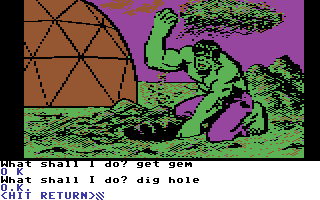
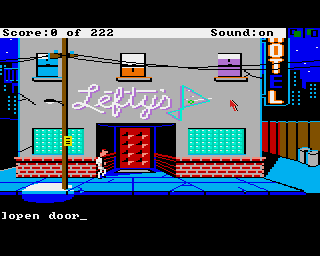
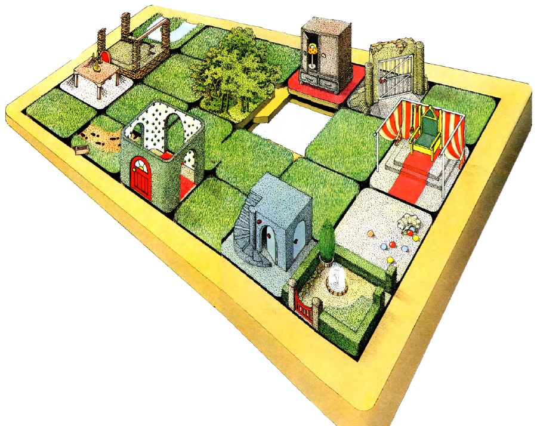
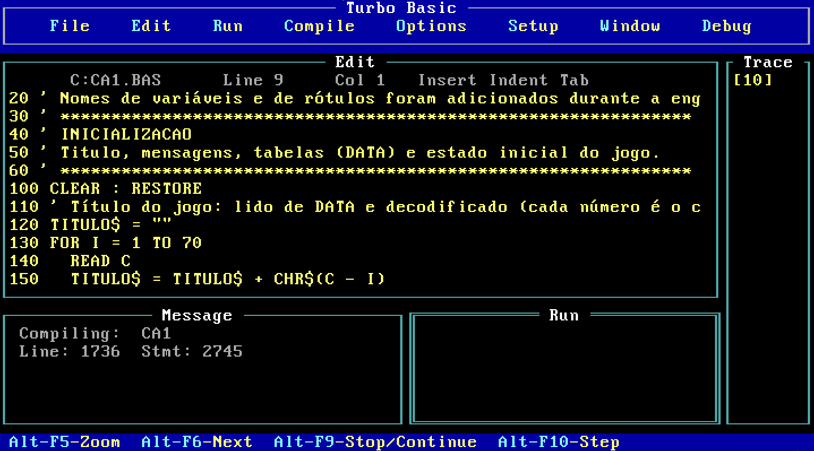
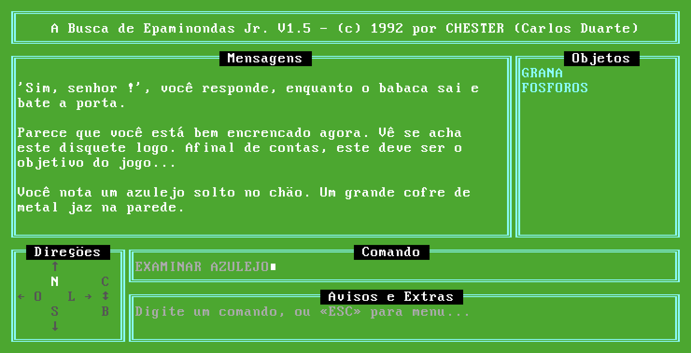
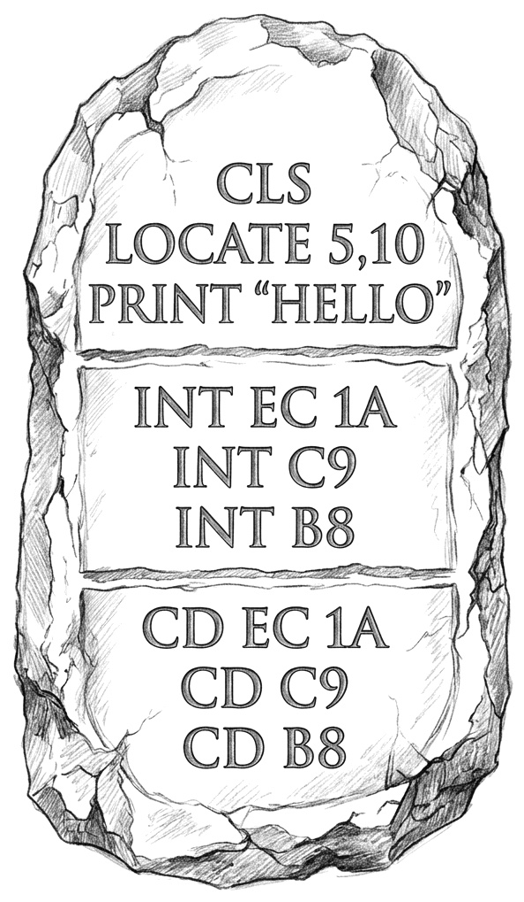
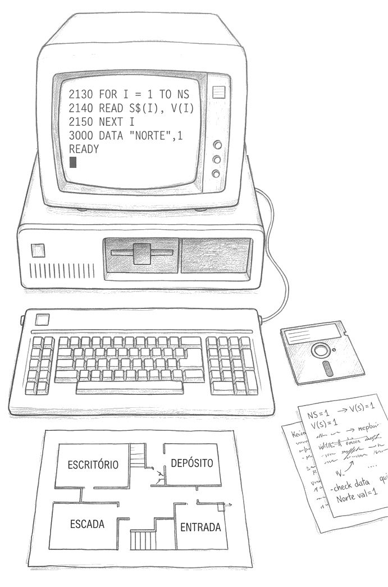
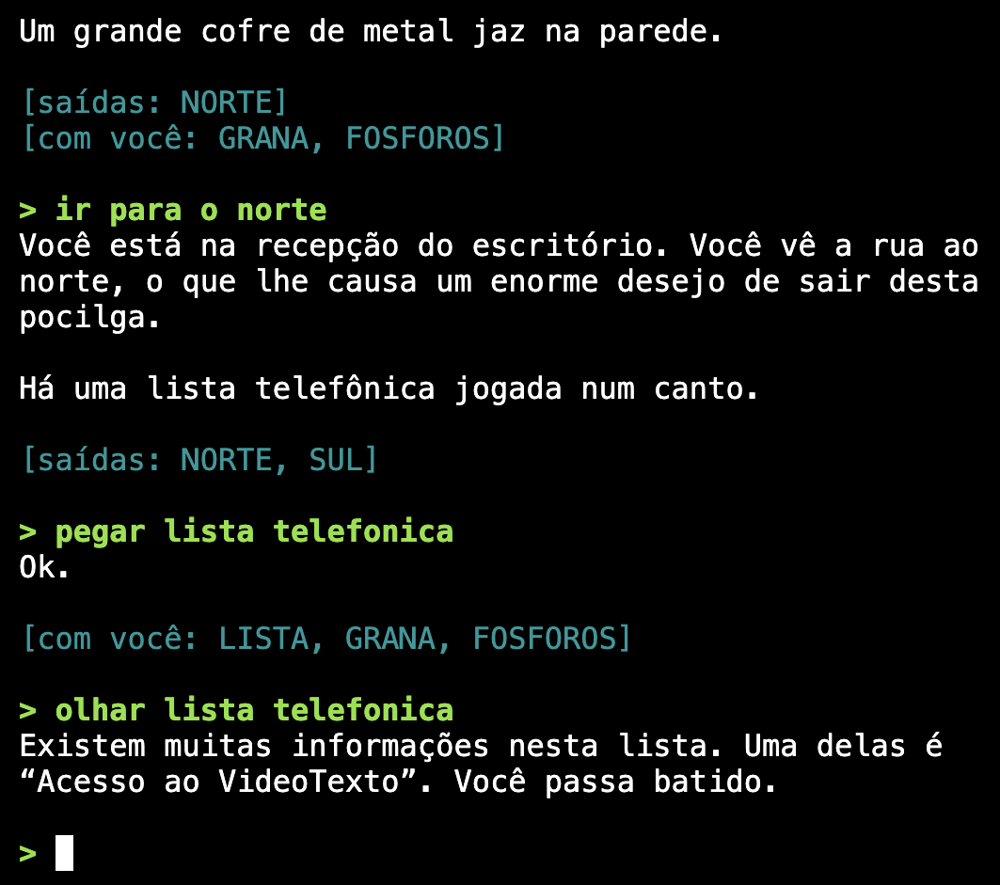

{: .right .invert-dark width="400" height="292" }

[Engenharia reversa em "sala limpa"](https://es.wikipedia.org/wiki/Dise%C3%B1o_en_habitaci%C3%B3n_limpia) é o jeito clássico (e, em geral, legal) de recriar um software sem acesso ao código dele: uma equipe documenta como o programa funciona, e outra, que nunca viu o programa original, escreve o código a partir dessa documentação. O resultado é uma recriação que, para fins de direito autoral, é inédita.

Recriar software assim costumava ser caro e demorado, mas as IA/LLMs mudaram isso. Surgiram ferramentas como o [Reverse Engineer Anything (REA)](https://github.com/morluto/rea), que liga agentes de IA a ferramentas de engenharia, e a coisa ganhou força quando alguém, cansado das [cobranças indevidas da Adobe](https://consumer.ftc.gov/consumer-alerts/2024/05/adobe-used-hidden-fee-trap-people-paying-subscription-plans-ftc-says), usou o Claude para recriar o Photoshop: o [Photocraft](https://github.com/storytold/photocraft) é um software equivalente, mas que vem com código-fonte e roda em Linux.

Daí pegou fogo: já recriaram [toda a suíte da Adobe](https://www.tweaktown.com/news/113989/developer-says-software-is-over-after-using-ai-to-recreate-adobes-entire-creative-cloud-suite-for-free/index.html) e [os programas do Office](https://petapixel.com/2026/10/12/there-are-free-open-source-versions-of-microsoft-office-apps-thanks-to-ai/), e estão aparecendo toneladas de [recriações de jogos de consoles em PCs](https://recompsoftware.com/recompiled-games-list/) (nem sempre em sala limpa). Foi quando me lembrei que tinha um candidato perfeito na gaveta: [**A Busca de Epaminondas Jr.**](/archives/2006/06/a_busca_de_epam/), um [adventure de texto](https://pt.wikipedia.org/wiki/Fic%C3%A7%C3%A3o_interativa#O_Meio) que escrevi em 1992, em Turbo Basic.

Na época eu nem sonhava com software livre, então distribuí só o executável, e o fonte se perdeu em algum disquete da vida. Já fiz disassembly e recriação de software profissionalmente (é surpreendente como empresas perdem código-fonte de coisas importantes), mas nunca me animei porque esse caso daria muito trabalho.

O advento da IA e o sucesso dessas recriações todas me incentivaram a tentar. Mas não foi só falar "Claude, descompila aí que eu vou tomar um café" - o buraco era _bem_ mais embaixo...

<!--more-->

### O tamanho do problema

A documentação do REA não fala sobre programas DOS de 16 bits, então o Claude sugeriu ir direto ao [Ghidra](https://github.com/NationalSecurityAgency/ghidra) (um dos analisadores que o REA sabe controlar). Botei o Ghidra pra importar o executável principal do jogo (`CA1.EXE`) e ele achou... uns 3% do código. 🫠

A compilação do Turbo Basic essencialmente embute uma biblioteca de runtime no executável, e transforma as instruções do programa em código que interage com esse runtime. Até aí era esperado; bastaria seguir o fluxo e identificar essas chamadas. O problema é que não são chamadas de sub-rotina tradicionais (`CALL`) - em vez disso, cada comando vira uma chamada de interrupção (`INT nn`), com os operandos (argumentos do comando) colados logo em seguida.

  
  
Inspiração: <a href="https://en.wikipedia.org/wiki/Questprobe_featuring_The_Hulk">Questprobe featuring The Hulk</a>

Pra deixar ainda mais "divertido": o runtime assume a presença de um coprocessador aritmético (8087) e injeta uma emulação deste quando um não é detectado. Até imagino o motivo: [BASIC](https://pt.wikipedia.org/wiki/BASIC) é uma linguagem onde os números são ponto flutuante até prova em contrário (um % no final da variável, se me lembro bem).

São dois truques marotos que viabilizaram uma compilação rápida e sem burocracia, essencial para o ciclo ágil de editar, rodar e depurar que era a marca da "família Turbo" da Borland ([Turbo Pascal](https://pt.wikipedia.org/wiki/Turbo_Pascal), [Turbo C](https://pt.wikipedia.org/wiki/Turbo_C), e até [Turbo Prolog](https://archive.org/details/borland-turbo-prolog-v2.0)). O efeito colateral é que eles fazem o Ghidra enxergar esses pontos do código como lixo, e ele não passa da inicialização do runtime.

### Análise Estática

Na [análise estática](https://pt.wikipedia.org/wiki/An%C3%A1lise_est%C3%A1tica) (olhar o código sem executá-lo) tem horas em que uma ferramenta _menos_ inteligente/automática ajuda a mapear melhor o problema. No caso, o [capstone](https://www.capstone-engine.org/) - uma biblioteca que tornou trivial escrever um decodificador em Python.

Por não ser tão sofisticado quanto o Ghidra, o script traduziu o código sem reclamar. O [resultado](https://github.com/chesterbr/a-busca-de-epaminondas-jr/blob/main/analise/extracted/ca1_code_listing.txt) foi uma listagem assembly linear, com um monte de chamadas de interrupção (`INT`) misteriosas.

Pra saber o que cada `INT` fazia, seria preciso futucar no próprio Turbo Basic - e eu nem lembrava qual versão usei. Baixei as versões 1.0 e 1.1 no [WinWorld](https://winworldpc.com/product/turbo-basic/1x); o Claude extraiu o `TB.EXE` de cada disco e comparou com o runtime embutido no jogo: 36 trechos batiam com a 1.0 e apenas 20 com a 1.1, indicando que era o 1.0 mesmo.

Faltava ligar cada `INT nn` à rotina certa do runtime, e essa ligação está na tabela de interrupções, que o runtime preenche logo no início da execução. Emulando só esse começo do executável (sem rodar o jogo de verdade) com o [Unicorn](https://www.unicorn-engine.org/) e lendo a tabela, o Claude mapeou qual rotina correspondia a cada `INT`.

Novamente comparando com o `TB.EXE`, deu para rotular as principais rotinas (comparação, `IF`, empilhar string, `PRINT`, etc). Nada de código-fonte ainda, mas já era um começo.

### Análise Dinâmica

Qualquer programa é uma combinação de algoritmos e estruturas de dados. A análise estática ajudou com os algoritmos, mas para as estruturas de dados não bastava: as variáveis são mantidas em posições de memória arbitrárias, e as tabelas (verbos, objetos, locais), que eram originalmente linhas `DATA`, viraram blocos de dados meio opacos.

  
  
Inspiração: <a href="https://en.wikipedia.org/wiki/Leisure_Suit_Larry_in_the_Land_of_the_Lounge_Lizards">Leisure Suit Larry</a>

Sem uma documentação clara sobre como o Turbo Basic armazena esses diferentes tipos de dados fixos e variáveis (números, strings, vetores, etc), foi preciso partir para a análise dinâmica, isto é: colocar o programa pra rodar e ver como esses dados se comportam.

Pra fazer isso, eu abri o jogo no [debugger do DOSBox-X](https://www.vogons.org/viewtopic.php?t=3944) e, orientado pelo Claude, fui colocando breakpoints (comando `BPINT`), jogando e fazendo dumps (descargas) da memória (`MEMDUMPBIN`), para que ele analisasse o que mudava entre um comando e outro, mapeando onde e como o estado do jogo era armazenado.

Essas comparações de dumps me lembraram o processo que a gente usava nos anos 80/90 pra "roubar" em jogos no Apple II: se o jogo começa, digamos, com três vidas, você inicia ele, tira um dump, perde uma vida, tira outro dump e procura todos os bytes `03` que mudaram para `02`. Com isso você acha onde as vidas ficam guardadas e pode criar um programa ([trainer](https://en.wikipedia.org/wiki/Trainer_(games)), em BASIC mesmo) que carrega o jogo, troca esse valor para `FF` e inicia o jogo carregado. Pronto: ele abre com 255 vidas!

No caso do Epaminondas foi preciso levar em conta a [segmentação de memória](https://tutorialdev.com.br/Linguagens/Assembly/8086/Arquitetura/Registradores.aspx) do 8086, mas rolou, e no final eu tinha mapeado todas as tabelas `DATA`: o título do jogo (ofuscado para evitar edição binária), 67 salas conectadas por até 6 saídas, 88 objetos (e a sala onde estavam), 34 verbos (com sinônimos). E também as diversas variáveis que controlam o estado: o comando digitado, o local atual, quais objetos e quanto dinheiro você tem, etc.

Com isso, o Claude escreveu um mini-[descompilador](https://pt.wikipedia.org/wiki/Descompilador) que transformou o assembly de cada verbo e de cada sala em pseudocódigo - ainda com vários (e literais) pontos de interrogação, mas já surgiam nele os detalhes (e dúvidas) sobre as regras do jogo.

### Memórias (humanas, não de computador)

Pra sanar as dúvidas levantadas pelo pseudocódigo, a inteligência artificial tinha que recorrer à minha memória natural, que, mesmo mais de 30 anos após o fato 👴, ainda tinha serventia pra esclarecer esses detalhes.

  
  
Inspiração: <a href="/download/input-adventure-de-texto-br.pdf">Adventure da Revista INPUT</a>

Por exemplo, eu lembrava por que quase todos os textos do jogo estavam no `AVENTURA.MSG` e não no binário: o editor do Turbo Basic tinha um limite de uns 64 KB por arquivo, e eu não sabia dividir o programa em módulos. Então fiz um programa para extrair essas strings do fonte e trocar por `MSG$(1)`, `MSG$(2)`, etc., carregando esse vetor na inicialização.

É o mesmo princípio de [internacionalizar um aplicativo moderno](https://docs.python.org/pt-br/3.14/library/gettext.html#internationalizing-your-programs-and-modules), só que sem textos simbólicos nem ferramentas para facilitar. E como eu fiz a extração quando o jogo estava uns 80% pronto, ficou uma maçaroca de mensagens dentro e fora do jogo. O `CA1.BAS` recriado continua lendo o `AVENTURA.MSG` e traz os textos em comentários; o Python e o `LEGIVEL.BAS` incluem eles no próprio código.

Lembrar disso ajudou a achar um bug que eu mesmo não percebi na época: um diálogo em que o texto "MESMO ???" nunca aparecia. Ele estava no `AVENTURA.MSG` como `'MESMO ???':GOSUB P`, indicando que o `GOSUB` foi engolido pela extração incorreta e virou texto. O mistério se resolveu - e como o objetivo era reproduzir o original, os fontes BASIC mantêm o bug.

Ainda tinha alguns trechos de lógica que nem eu acreditava que tinha escrito, mas outro eco do passado matou a charada: eu não tinha mesmo! Na verdade, aprendi muito com o [adventure da revista INPUT](/download/input-adventure-de-texto-br.pdf), e boa parte dele aparece no meu código. Uma [versão digitada do adventure](https://github.com/C64-Mark/C64-Listings/blob/0ae8daf1d0c53ee3f4aa958179618f900052c1f5/Input%20Magazine%20Vol%201/p0386.bas) esclareceu a estrutura de vetores e tirou a dúvida sobre trechos confusos (como o `ON L GOSUB` em blocos de 10 em 10).

Também tinha esquecido de onde tirei a ideia de colocar texto, comando, saídas e objetos em "janelas" de caracteres gráficos do IBM-PC, até olhar a IDE do Turbo Basic, exatamente para onde eu olhava quando criei o adventure. Veja a semelhança:

{: .center width="640" height="355" }

{: .center width="640" height="328" }

O Claude foi documentando todos esses aprendizados na versão Python. Pode parecer estranho escrever uma versão nova antes de recriar o original em BASIC, mas foi mais fácil partir para o BASIC depois de entender todas as nuances, e o Python servia como prova de que a gente não esqueceu nenhuma: se ele se comportasse como o original no DOSBox, o script gerador BASIC sairia naturalmente depois.

### Automação

Quando a memória não ajudava a esclarecer o que acontecia em determinadas salas e situações do jogo, eu ia testando manualmente e repassando as respostas. No começo foi divertido revisitar esses lugares do jogo, mas uma hora eu cansei e perguntei se ele não conseguia pilotar o DOSBox sozinho. O plano acabou sendo um conjunto de scripts que rodavam o jogo no emulador, enviavam os comandos tecla por tecla e liam o texto da tela por OCR.

Não foi trivial porque vira e mexe os eventos de teclado sumiam ou "vazavam" para outros aplicativos, mas eventualmente chegamos em uma ferramenta que funcionava. E com ela foi possível criar roteiros - 45 no total - que incluíam as duas conclusões do jogo, as mortes, os becos sem saída, as pegadinhas que eu lembrava de ter criado e até algumas que eu tinha esquecido.

Esses roteiros podiam ser "executados" no jogo original com a mesma ferramenta, tornando eles uma suíte de testes de integração - bastava rodar e comparar a saída com a do roteiro. E o melhor: o mesmo processo podia ser aplicado na versão Python, garantindo que ela traduz fielmente o conteúdo do jogo original e pode ser usada como base para futuras encarnações.

### De volta ao _básico_ 🥁

Com o Python fiel ao original (os mesmos roteiros davam o mesmo resultado nos dois), dava para voltar ao projeto sentimental: recuperar o fonte em BASIC.

{: .right .invert-dark width="220" height="377" }

O primeiro ponto a resolver eram os `INT` ainda misteriosos (os rótulos do começo eram palpites e o pseudocódigo era aproximado). O Claude ficou com a tarefa de compilar programas de uma linha com os comandos BASIC mais comuns, ver quais INT eles geravam e fazer um [mapeamento](https://github.com/chesterbr/a-busca-de-epaminondas-jr/blob/main/basic/rosetta/README.md) que ele nomeou a "[Pedra de Roseta](https://pt.wikipedia.org/wiki/Pedra_de_Roseta) do Turbo Basic". O mapeamento traduz cada um dos `INT nn` no comando BASIC (ou emulação de 8087) que ele representa.

Com ela, a abordagem foi escrever um script descompilador: ele lê o executável, reconhece os INTs e outros maneirismos do compilador, e escreve o BASIC. Como o Turbo Basic 1.0 estava ali no DOSBox (e agora ele podia testar sem me envolver), o ciclo era: gerar o `.BAS`, compilar, comparar com o `CA1.EXE` original, ver onde divergia, ajustar uma regra do gerador, repetir.

Os achados são o tipo de coisa que só se aprende compilando: `IF` de uma linha e `IF` em bloco geram código diferente, parênteses mudam o código. Um código como `COLOR 8` seguido de `IF c THEN COLOR 15` (que era comum em dialetos BASIC que não tinham `ELSE` - o Turbo Basic tinha mas eu frequentemente esquecia) não compila igual a `IF c THEN COLOR 15 ELSE COLOR 8`.

Pelo menos o compilador não fazia muitas otimizações (e nem precisava - a maior parte do processamento ficava no runtime, e só de não ter que interpretar o BASIC, o compilado não corria, ele "voava baixo").

Em paralelo com esse `CA1.BAS`, fizemos a versão para humanos, o [`LEGIVEL.BAS`](https://github.com/chesterbr/a-busca-de-epaminondas-jr/blob/main/basic/gerado/LEGIVEL.BAS): no lugar dos números de linha, _labels_ com os nomes de rotinas, verbos, etc., comentários dizendo que objeto ou sala é cada número, 80 colunas, etc. Os nomes das variáveis e rotinas eu fui colocando com a memória e o bom senso.

Essa versão é para ler, não para compilar: com o texto das mensagens no fonte ela passa do limite de tamanho do editor do Turbo Basic que mencionei acima, e, compilada, o jogo mostra as mensagens misturadas (suspeitamos que o compilador não comporte tantos textos juntos). Para testar o comportamento dela, o Claude gerou uma variante idêntica que lê o `AVENTURA.MSG`, e os 45 roteiros deram o mesmo resultado do original.

### Um último mistério

O código do programa recompilado ficou praticamente idêntico ao original, mas sobraram 54 lugares onde dois bytes diferiam, todos logo depois de uma conversão de número para inteiro (`FISTP`): no original havia dois `NOP` (`90 90`) e no meu recompilado, um `CD 3D`.

Eu sabia que isso tinha a ver com o coprocessador aritmético (FPU) 8087. Compiladores da época costumavam gerar um executável único, que funcionava com ou sem ele: em vez das instruções de FPU, eles emitiam `CD 34` a `CD 3D`, que são interrupções de software (`INT 34h` a `INT 3Dh`) atendidas por um emulador (lento) embutido no runtime.

Se uma FPU é detectada na inicialização, o runtime troca cada `CD nn` por `90 xx`, onde `90` é `NOP` (não faz nada) e `xx` é o opcode real do 8087. O `CD 3D` é o caso do `FWAIT` (opcode `9B`), a instrução que faz a CPU esperar a FPU terminar antes de usar o resultado: com FPU ele viraria `90 9B`. Mas por que o original tinha dois `NOP` (`90 90`) justamente onde o meu recompilado tinha o `CD 3D`?

{: .right .invert-dark width="300" height="454" }

Descartamos o fonte (o gerador estava certo) e as opções do compilador (testamos as cinco opções do menu). Até que eu lembrei de um detalhe: meu PC de casa tinha um 8087 (algo raro, ele foi comprado de segunda mão), mas de vez em quando eu levava o programa para o trabalho, onde o hardware era outro. Ou seja, o executável distribuído podia ter sido gerado tanto numa máquina com coprocessador quanto numa sem.

Isso foi a chave pra descobrir que a IDE do Turbo Basic compila o programa na RAM quando a gente testa ele, e o "Compile to EXE" grava em disco essa memória como ela está naquele momento. Quando não há FPU de verdade, o runtime troca cada `CD 3D` por dois `NOP` **na primeira vez que o trecho é executado** (provavelmente para não pagar o custo da interrupção toda vez, sendo que nem tem coprocessador pra aguardar).

Ou seja: o `CA1.EXE` que eu distribuí foi compilado numa máquina sem FPU (provavelmente a do trabalho), logo depois de eu rodar o jogo **dentro da IDE**, e os trechos por onde eu passei saíram com `NOP`.

Para provar, o Claude reproduziu o ritual (rodar o jogo no editor, passar da abertura, entrar em todos os menus, sair, compilar) e as 54 diferenças sumiram. As diferenças restantes eram relacionadas ao estado da memória da IDE e estavam todas fora do código. Missão cumprida: o executável original foi reproduzido!

### O resultado

Os frutos dessa jornada estão todos [no GitHub](https://github.com/chesterbr/a-busca-de-epaminondas-jr) (junto com os scripts e dumps intermediários):

- **BASIC**, em dois sabores:
  - [`CA1.BAS`](https://github.com/chesterbr/a-busca-de-epaminondas-jr/blob/main/basic/gerado/CA1.BAS): o mais próximo do fonte que eu perdi (macarrônico como veio ao mundo 🙈), que recompila para o mesmo código do executável original
  - [`LEGIVEL.BAS`](https://github.com/chesterbr/a-busca-de-epaminondas-jr/blob/main/basic/gerado/LEGIVEL.BAS): reformatado, comentado e mais legível para olhos contemporâneos
- **Python**, como versão de referência: para [jogar na linha de comando](https://github.com/chesterbr/a-busca-de-epaminondas-jr/blob/main/python/epa.py) ou [direto no navegador](https://chester.me/a-busca-de-epaminondas-jr/python.html).

  
  
Versão em Python (no terminal)

Com esses artefatos não só é possível observar como um jogo daquela época era feito, mas também trazer ele pra era moderna com [melhorias](https://github.com/chesterbr/a-busca-de-epaminondas-jr/issues): quando tiver um tempo, pretendo fazer um autosave que evite ter que começar do início caso algum erro muito grande seja cometido sem um save anterior, talvez até adicionar gráficos (como os adventures da [Marvel/Questprobe](https://adventuregamers.com/gameseries/questprobe) e da [Sierra On-Line](https://archive.org/details/20220303_20220303_0527) que me inspiraram tanto).

Se quiser jogar, [o original também roda no navegador](https://chester.me/a-busca-de-epaminondas-jr/original.html) (e se travar, agora tem [a solução](https://github.com/chesterbr/a-busca-de-epaminondas-jr/blob/main/python/caminhos/00_caminho_feliz.txt) - SPOILERS). E me conta se você chegou ao final com ou sem a chave.

### Considerações finais

As ferramentas de engenharia reversa e clonagem de software por IA funcionam muito bem - tanto que [a Anthropic está tentando bloquear os usos mais questionáveis](https://supernovas.gg/a-anthropic-bloqueia-recompilacoes-no-claude-que-caracterizem-clones-de-jogos-mas-continua-de-bracos-abertos-para-o-roubo-por-ia-de-todas-as-outras-artes/) (não é o caso aqui, já que o jogo é meu mesmo). A real, pra mim, é que não dá pra colocar o gênio de volta na garrafa, e a gente vai ter que conviver com a ideia de que um programa já não se protege de modificação e clonagem apenas por ser compilado.

Outro ponto é que, como em muitos dos casos de uso de IA em software, é possível fazer [_vibe coding_](https://pt.wikipedia.org/wiki/Vibe_coding), isto é, sem entender ou observar muito o que está sendo gerado. Tem [gente famosa alucinada com essa ideia](https://www.youtube.com/watch?v=vDjW_dRyKXY), mas não é pra mim - ao menos por ora eu ainda me importo com a qualidade do código, independentemente de como ele foi escrito. No final das contas, é o **meu** código, e eu que respondo por ele - profissional ou artisticamente.

